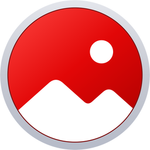
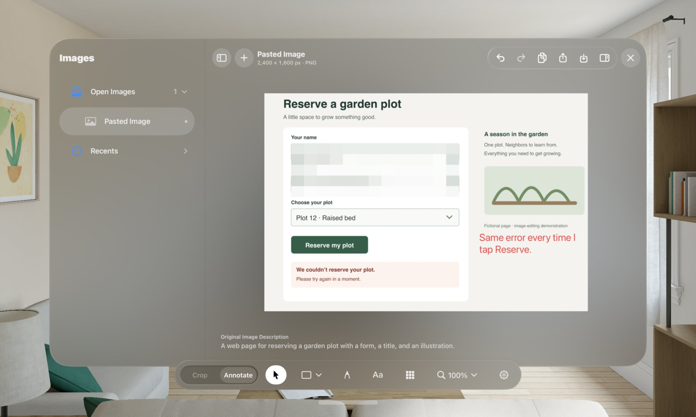

# Glass Image Tools



> Crop, mark up and share screenshots. Native on Mac and Apple Vision Pro.

[](./LICENSE)
[](https://developer.apple.com/swiftui/)
[](https://www.apple.com/apple-vision-pro/)
[](https://www.apple.com/macos/)
[](https://github.com/sponsors/msitarzewski)

Glass Image Tools is a native image editor for Apple Vision Pro and Mac. Open a screenshot from Photos, Files or the clipboard, crop it in the original's pixels, add arrows, boxes, text and pixelation, then Copy it into a chat, Share it, or save a new image. Your original is never changed. It's native, with no accounts, tracking or third-party dependencies. Explicitly pasting a direct HTTPS image link downloads that image; editing stays local.

**Mac download:** [Glass Image Tools 1.0 (45)](https://github.com/msitarzewski/GlassImageTools/releases/download/mac-v1.0/GlassImageTools-1.0-mac.dmg) · [ZIP](https://github.com/msitarzewski/GlassImageTools/releases/download/mac-v1.0/GlassImageTools-1.0-mac.zip) · [checksums](https://github.com/msitarzewski/GlassImageTools/releases/download/mac-v1.0/SHA256SUMS.txt). macOS 26+, Apple silicon and Intel; Developer ID signed, notarized and sandboxed. **Vision Pro:** [build from source](#build-and-run); no TestFlight distribution yet. **Website:** [Home](https://msitarzewski.github.io/GlassImageTools/), [Help](https://msitarzewski.github.io/GlassImageTools/help.html), [Privacy](https://msitarzewski.github.io/GlassImageTools/privacy.html).

<p align="center">
  
</p>
<p align="center"><sub>The editor in Apple's Vision Pro simulator, on a page made up for the screenshot. <a href="https://msitarzewski.github.io/GlassImageTools/credits.html">Credits</a>.</sub></p>

## How it works

1. **Open a screenshot.** Take one the usual way (top button and Digital Crown together, or Siri), then use the large Photos or Files option, drop an image into the empty window, or tap the drop/Paste well (⌘V also pastes there). Apple's pickers give the app only the image you choose; it never asks to read your library.
2. **Crop it.** Drag the corners or type exact Left, Top, Width and Height in the original's pixels. Freeform, 1:1, 16:9 and 4:3 presets, Rotate Left, and zoom to 800%. The crop always comes from the full-resolution original.
3. **Mark it up.** Rectangle, rounded rectangle, ellipse, triangle, speech bubble, line, arrow, freehand drawing, text and Pixelate, with one inspector for whatever is selected. Everything stays editable until the image is closed.
4. **Copy or share it.** Copy puts a PNG on the clipboard (the same as Share › Copy). Export offers PNG or JPEG, Share, Save to Files and Save New Image to Photos. New images carry no location or camera metadata.

Several images can be open in one window, each with its own edits and Undo; closed ones stay in Recents for the session. Paste also accepts one direct HTTPS image link, including a URL copied as text. Webpages and images requiring a browser login may not load; copy the image itself instead. Downloads use the same size limits and protected temporary ownership as other imports. The native Images sidebar groups Open Images and Recents with compact icon/filename rows. Open Images starts expanded and Recents collapsed; the toolbar button shows or hides the sidebar. On visionOS 27 with Apple Intelligence on, a one-sentence description of the original appears under it, made on the headset and never saved.

## Privacy

- **No backend, account, analytics or crash reporting.** Pasting a direct HTTPS image link contacts its host to download the image. That host sees your IP address and requested URL, including any query. No existing image is uploaded; requests use no cookies, saved credentials or persistent cache.
- **Add-only Photos permission**, only to save a new image there. Apple can also request clipboard consent when you explicitly paste content from another app.
- **Nothing kept between sessions** except the window's appearance settings. Working copies live in the app's temporary folder and are deleted when closed, or at the next launch after a force-quit.
- Copy, Share and Save hand the image to Apple's clipboard (including Universal Clipboard), share sheet and Photos, which work as Apple designed them.
- **From TestFlight or the App Store**, Apple adds crash reports of its own, which the app doesn't control; [PRIVACY.md](./PRIVACY.md#testflight-and-the-app-store) says what and when.

The details are in [PRIVACY.md](./PRIVACY.md).

## Mac version

Download the disk image above, open it and drag Glass Image Tools to Applications. The same native, sandboxed Mac app builds from the `GlassImageToolsMac` scheme (macOS 26+).
It shares full-resolution crop, rotation, editable vectors, pixelation and PNG/JPEG export with the headset app.
Mac windows use Apple's NavigationSplitView, sidebar, inspector, toolbar and Open/Save panels.
The editing toolbar follows Vision Pro: mode, crop/annotation tools and zoom. A native Markup toggle,
View menu and ⌘⇧M hide/show the row. Open Image precedes the title; standard toolbar groups separate
history, document actions and Markup/Settings/Inspector. The compact, centered editing row uses native borderless controls,
consistent targets, standard menu arrows and separators following Preview. Image menu commands mirror
editing tools. Annotate groups
shapes in one chooser beside Select, Draw, Text and Pixelate, using a native Mac accessory row.
Open with ⌘O, paste image bytes or a direct HTTPS image link with ⌘V, Copy with ⌘C when the canvas is focused,
and export with ⌘S. Text fields keep native editing commands. Save, Discard and Cancel protect unsaved work on close/quit.
This app does not add screenshot capture. Photos saving, recipient interoperability, VoiceOver and performance profiling on Mac still need separate acceptance.

## Requirements

- Apple Vision Pro with visionOS 26 or later (the image description needs visionOS 27 and Apple Intelligence)
- Mac app: macOS 26 or later (optional local image descriptions require macOS 27 and a compatible Apple Intelligence model)
- To build: Xcode 27; include the visionOS SDK for the headset target

## Build and run

```sh
git clone https://github.com/msitarzewski/GlassImageTools
cd GlassImageTools
swift test                         # the image core, on the Mac
open GlassImageTools.xcodeproj     # run the GlassImageTools scheme
```

The simulator needs no signing. For a headset, create `Config/Identity.local.xcconfig` (ignored by Git) with your own `DEVELOPMENT_TEAM` and a unique `VISIONSNIP_BUNDLE_ID`, choose your paired Vision Pro, and run. Builds installed with a free Apple Account expire after seven days.

From the command line:

```sh
xcodebuild -project GlassImageTools.xcodeproj -scheme GlassImageTools \
  -destination 'generic/platform=visionOS Simulator' -derivedDataPath build build
```

The Xcode project is checked in; [XcodeGen](https://github.com/yonaskolb/XcodeGen) 2.42 or later regenerates it from `project.yml` after target or settings changes.

To run the native Mac app, select **GlassImageToolsMac → My Mac** in Xcode, or:

```sh
xcodebuild -project GlassImageTools.xcodeproj -scheme GlassImageToolsMac \
  -destination 'platform=macOS' -configuration Release -derivedDataPath build build
open build/Build/Products/Release/GlassImageToolsMac.app
```

Use your own ignored signing override for Mac too. App Sandbox permits user-selected read/write files,
Photos operations and outgoing connections needed for explicit image-link Paste; it grants no full-disk,
whole Pictures/Downloads folder, server or capture access. See [Mac validation](memory-bank/261105_native-sandboxed-mac.md).
The Mac icon is generated from the existing Glass artwork; [recipe](Tools/Icon/README.md#mac-icon).

## Architecture

| Owner | Responsibility |
|---|---|
| `Sources/VisionSnipCore` | Immutable source ownership, crop geometry, import limits, annotation rendering, Pixelate and full-resolution, metadata-free output |
| `App/EditorModel.swift` | One image's edits, Undo history and tools |
| `App/DocumentWorkspace.swift`, `DocumentSidebar.swift` | The images in a window, session Recents, close and save |
| `App/EditorView.swift`, `ImageCanvas.swift`, `AnnotationInspector.swift` | Native controls, inspectors, view transforms and gestures |
| `Sources/VisionSnipCore/ImageLinkImportService.swift` | Explicit, bounded, cancellable HTTPS image download into the existing importer |
| `App/ExportView.swift`, `ExportService.swift` | Clipboard, sharing, Files and add-only Photos saving |
| `App/ImageDescriptionCaption.swift`, `ImageDescriptionService.swift` | The session-only description from Apple's on-device model |
| `App/AppearanceSettings.swift` | The window background's Opacity and Glass |
| `CaptureProbe` | A separate visionOS 27 screen-capture experiment; [no capture path is confirmed](Documentation/CAPTURE_CAPABILITIES.md) |

Previews are capped at 2,048 pixels; the full-resolution source is kept for output, and decoding and export run off the main actor. Imports over 256 MiB or 200 megapixels, and exports over 100 megapixels, are refused. These input limits do not guarantee a maximum memory footprint; rendering and encoding require additional allocations.

## Status and testing

Mac **1.0 (45)** adds a verified Quit fix to the compact, centered native Markup toolbar. Save before Quit now asks through AppKit before termination starts, then saves edited windows in sequence. Guest checks cover Cancel, export cancellation, Discard, sequential PNG saves, unchanged originals and actual process exit. [Mac release details](Documentation/MAC_RELEASE.md). VisionOS source remains **1.0 (38)**; the last verified headset build is 36.

Retained visionOS build-37 evidence: 78 core tests in five suites and eight focused native visionOS UI cases pass. Coverage includes URL and plain-text Paste through menu/Command V with real HTTPS downloads and PNG Copy, original-byte/crop output, transfer/redirect bounds, failure/cancellation cleanup, ordinary image Paste and largest-text accessibility. Signed Release build/analyze and strict signature pass. The full UI/service suites were not rerun; physical browser clipboard consent, cross-app Drop, assistive technology and large-image resource acceptance still need scoped headset checks.

The everyday Photos → crop → Copy → ChatGPT path has worked about ten times by the author's count; the author has also saved to Photos and Files, used a hardware keyboard and pasted into other apps. Direct image-link Paste has current simulator acceptance; owner hardware acceptance remains separate.

[Release notes](Documentation/RELEASE_NOTES.md), [verified status](Documentation/STATUS.md) and [accessibility audit](Documentation/ACCESSIBILITY_AUDIT.md) retain exact evidence and remaining checks.

## App Store and TestFlight preparation

The [Apple submission packet](Documentation/AppStore/README.md) contains current listing text, review notes, TestFlight information and retained native screenshots for visionOS source 1.0 (38). It is prepared locally; no distribution upload or Apple review is claimed. The Mac download is distributed separately through GitHub Releases; Apple submission and hardware acceptance remain separate. [The entry guide](Documentation/AppStore/SUBMISSION.md) identifies the remaining account-only steps.

## Contributing

See [CONTRIBUTING.md](./CONTRIBUTING.md). The project is built with AI coding assistants following [AGENTS.md](AGENTS.md); its [memory bank](memory-bank/toc.md) records every change and its evidence. The [product contract](Documentation/BUILD_BRIEF.md) defines the scope.

## Other projects

Also by [Michael Sitarzewski](https://github.com/msitarzewski), all open source:

- [**AudioPaper**](https://msitarzewski.github.io/AudioPaper/): your Mac's desktop, set to the music you're playing.
- [**AutoPaper**](https://msitarzewski.github.io/AutoPaper/): new AI wallpapers from a few keywords, for macOS, Windows and Linux.
- [**Agency Agents**](https://github.com/msitarzewski/agency-agents): a library of specialized AI agent personas for coding assistants.
- [**Brew Browser**](https://brew-browser.zerologic.com): a native Mac app for Homebrew, the macOS package manager.
- [**AGENT-ZERO**](https://github.com/msitarzewski/AGENT-ZERO): the AGENTS.md workflow this project is built with.
- [**BEDROCK**](https://github.com/msitarzewski/bedrock): a free library about how a person becomes who they are.

## Support

Glass Image Tools is free and MIT-licensed. If it saves you a trip to another device, you can [sponsor its development on GitHub](https://github.com/sponsors/msitarzewski).

## License

[MIT](./LICENSE) © 2026 Michael Sitarzewski.
